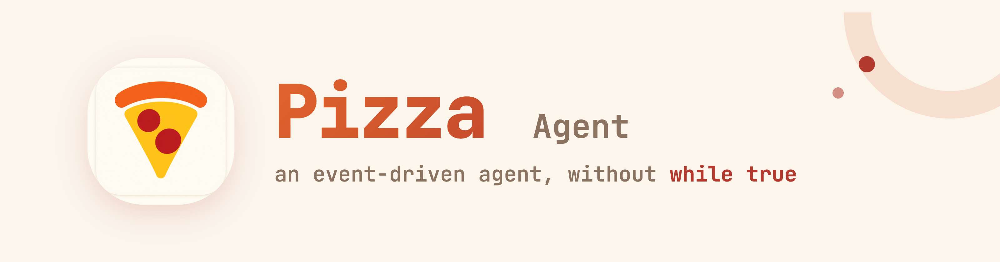

<p align="center">
	
</p>

Pizza is an event-driven agent, without `while true`. Every conversation, tool call, and file edit is an event in an immutable log. Your UI, the LLM context, and the session tree are all projections of that log.

[](https://www.npmjs.com/package/@tomsun28/pizza)
[](https://github.com/pizza-agent/pizza/actions/workflows/ci.yaml)
[](./LICENSE)

[English](./README.md) · [简体中文](./README.zh-CN.md)

## About It

### Under the hood

- **Reactor-driven turn cycle**
  Unlike `Pi, Claude Code, and Codex`, Pizza does not run the agent loop as a brittle `while true` loop. Each turn is a state machine driven by an event-handler table. The result: interrupts, retries, parallel tool calls, and mid-turn failures can all be handled reliably.

- **The log is the single source of truth**
  Every message, model call, tool result, and file change is written to an immutable `EventStore` (SQLite). The UI, the LLM context, and the session tree are all live projections of that log. State is no longer hidden in mutable objects — it can be rebuilt, audited, and replayed, because the log is the single source of truth.

- **Only one execution tool — the CLI**
  JSON is program-friendly at the API level but not model-friendly. Pizza aggressively gives the model only one tool: the `CLI Tool`. The model uses it to call `_read`, `_write`, `_edit`, and other command-line commands. Surprisingly, it performs better, is more stable, and burns fewer tokens.

- **All interfaces share the same runtime**
  The desktop GUI, interactive TUI, JSON-RPC server, and one-shot print mode all consume the same `SessionFacade` event stream. Script it, embed it, or chat with it directly in the terminal — it is the same agent.

### Memory & collaboration

- **Why New Session**
  In Pizza, you do not need to manually create a new session. Think of it as a long-term task for a friend you can chat with for ten years. A friend will manage their own context.

- **Extreme token efficiency**
  One tool means one small schema on every call — the model never carries a pile of tool definitions. And when context fills up it compacts automatically: old tool results masked for free, a summary only when needed.

- **Git log-like branch tree memory**
  Sessions can fork from any earlier message. Rewind, branch, compare. Restart your life anytime, anywhere.

- **Agents collaborate with agents — free passage between workspaces**
  Any agent can talk and collaborate with another workspace's agent via `tell`. The conversation is continuous — the other side gets the job done in its own workspace, and other projects' details never leak into your context.

### Ecosystem

- **Any SSH host is a workspace**
  Point Pizza at a remote machine and it deploys itself there — the agent works on the remote box like it's a local project.

- **Chat where you already are**
  The gateway connects Slack, Discord, Telegram, Lark, voice, and webhooks to the same agent.

- **It keeps working while you're away**
  Built-in cron scheduling for recurring tasks, plus a persistent "main" agent that's always on.

- **Bring your own model**
  40+ providers — Anthropic, OpenAI, Google, DeepSeek, GLM, Kimi, and more — via API key or OAuth subscription login.

- **Hackable by default**
  MCP servers, skills, hooks, extensions, themes — plus JSON-RPC / FS-RPC modes and an SDK for embedding.

## Quick Start

### Connect GitHub MCP

Install GitHub from **Settings → Plugins → MCPs → MCP Marketplace**. Pizza starts sign-in and displays a device verification code. Choose your GitHub account, enter the code, and authorize Pizza in the browser. Pizza saves credentials, reconnects, and loads the tools automatically. The installed entry supports viewing tools, signing in again, and signing out. Cancelling or failing sign-in keeps the entry available for retry.

GitHub uses Device Flow, so users do not configure a client ID or secret or need a loopback callback. The Pizza OAuth App maintainer must enable **Device Flow** in GitHub's app settings. Existing installs using Pizza's client ID automatically use this flow. Clients configured with `oauth.clientSecret` keep authorization code + PKCE. Other MCP callback pages use Pizza branding and only report success after tokens have been exchanged and saved.

In a terminal, run `pizza mcp login github --timeout 900` and follow the device-code prompt. Credentials are stored in `mcp-auth.json` in Pizza's agent configuration directory; `pizza mcp logout github` clears the local credentials.

### Connect Gmail MCP

Install Gmail from the MCP Marketplace and sign in with Google. Pizza uses its registered Desktop OAuth client with PKCE, an automatic loopback callback and refreshable credentials. No per-user Google Cloud project, Web client secret or Gmail MCP Developer Preview enrollment is needed. The bundled MCP adapter runs inside Pizza and calls the stable Gmail API directly.

Tools cover mailbox identity, labels, paginated search, messages, threads, attachments and draft creation/editing. Replies are saved as threaded drafts for review in Gmail. Connection is verified with a read-only labels request. The product maintainer must enable Gmail API, configure the consent screen/test users, and complete Google's verification for public distribution of the requested restricted scopes. Advanced manually configured Google-hosted preview MCPs retain their own OAuth setup.

Release builds must supply the **Desktop** registration JSON with `PIZZA_GOOGLE_DESKTOP_CLIENT_FILE=/path/to/desktop-client.json npm run build` (or the corresponding desktop build). The build copies only the matching `installed` client registration into the runtime assets and rejects Web clients. Google still requires the Desktop `client_secret` field at token exchange; for installed applications it is a public registration value, not a confidential credential. PKCE protects each authorization exchange. Keep the original JSON outside the source tree. User access and refresh tokens are never packaged. See [Google's installed application guidance](https://developers.google.com/identity/protocols/oauth2#installed).

### Connect Notion and X MCP

Notion supports dynamic OAuth client registration. Install Notion from the MCP Marketplace and authorize your workspace in the browser; no separate developer app is needed. Pizza requests the standard `default` scope, validates the issuer on the callback, and stores refreshable credentials.

X connects directly to `https://api.x.com/mcp` using Pizza's OAuth flow. Create an X developer app with OAuth 2.0 enabled and register `http://127.0.0.1:8766/callback`. In Pizza's X setup, a **Native App** needs only its OAuth 2.0 Client ID; **Web / Automated Apps** also require a client secret. Initial access uses `tweet.read users.read offline.access`, including token refresh. Actual tool access depends on the app's API enrollment and plan. Existing marketplace xurl entries can be converted through the X setup form; custom stdio configurations remain available. See [X's OAuth guide](https://docs.x.com/fundamentals/authentication/oauth-2-0/authorization-code).

### Desktop

Download the installer for your platform (macOS / Linux / Windows) from [GitHub Releases](https://github.com/pizza-agent/pizza/releases), install and launch.

**For macOS users**: Since the app is unsigned, you may see "Pizza.app is damaged and can't be opened". Run the following command in Terminal to fix this:

```bash
xattr -cr /Applications/Pizza.app
```

### CLI

```bash
npm install -g @tomsun28/pizza
pizza
```

### One-shot & scripting

```bash
pizza -p "summarize this repo"      # one-shot print mode
pizza --mode rpc                    # JSON-RPC server
pizza --continue                    # resume the previous session
pizza --export session.html         # export a session as a shareable HTML page
```

## Acknowledgements

Pizza's shell comes from Pi → Pizza. Thanks to the Pi project for open-sourcing.

## License

[Apache-2.0](./LICENSE)
