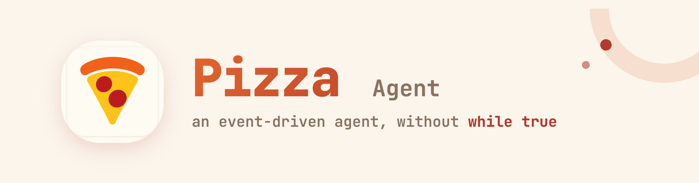

<p align="center">
	
</p>

Pizza 是一个事件驱动的 agent，没有 `while true`。你的每一次对话、工具调用和文件修改，都是不可变日志里的一条事件。UI、LLM 上下文和会话树，都只是这条日志的投影。

[](https://www.npmjs.com/package/@tomsun28/pizza)
[](https://github.com/pizza-agent/pizza/actions/workflows/ci.yaml)
[](./LICENSE)

[English](./README.md) · [简体中文](./README.zh-CN.md)


## 关于它

### 底层设计

- **Reactor 驱动的 turn 循环**
  区别于 `Pi, Claude Code, Codex`，Pizza 没有用一个脆弱的 `while true` 循环来跑 agent 主循环。每一次 turn 都是一张事件-处理器表驱动的状态机。结果是：中断、重试、并行工具调用、turn 内失败都能被可靠处理。

- **日志是唯一事实来源**
  每一条消息、每一次模型调用、每一个工具结果、每一次文件变更，都会被写入不可变的 `EventStore`（SQLite）。UI、LLM 上下文、会话树都是这条日志的实时投影。状态不再藏在可变对象里 —— 它可以被重建、审计、回放，因为日志就是唯一的事实来源。

- **只有一个执行工具 - CLI**
  JSON 在 API 层对程序处理友好但对模型可不是，Pizza 激进的只提供给模型一个工具 - `CLI Tool`, 模型通过其来调用 `_read`、`_write`、`_edit` 和其它命令行命令，出乎意料的是，它表现的更好更稳，还更省 token。

- **所有界面共享同一个运行时**
  桌面 GUI、交互式 TUI、JSON-RPC 服务、单次打印模式都消费同一个 `SessionFacade` 的事件流。你可以脚本化它、嵌入它，或者直接在终端聊天 —— 它是同一个 agent。

### 记忆与协作

- **为什么要 New Session**
  在 Pizza 中你不需要手工去新建会话，把它看作你可以持续聊十年的朋友的长程任务，朋友自己会去管理好自己的上下文。

- **极致的省 token**
  只给模型一个工具：每次调用就一个小 schema，不用背一堆工具定义。上下文快满时自动压缩，旧工具结果用占位符遮掉不花钱，不够才写总结。

- **Git Log 一样的分支树记忆**
  会话可以从任意一条历史消息分叉。回退、分支、对比。随时随地重开人生。

- **Agent 之间自由通行协作**
  任意 agent 都能通过 `tell` 与另一个工作区的 agent 相互交流协作。对话是连续的 —— 对方会在自己的工作区里把事办了，其它项目的细节不会泄漏进你的上下文。

### 生态

- **任何 SSH 主机都是工作区**
  指向一台远程机器，Pizza 会把自己部署上去 —— agent 在远程机器上干活，就像在本地项目里一样。

- **在你已有的地方找到它**
  gateway 把 Slack、Discord、Telegram、飞书 / Lark、语音电话和 webhook 都接到同一个 agent 上。

- **你不在，它也在干活**
  内置 cron 定时任务处理周期性工作，外加一个永远在线的常驻 main agent。

- **带上你自己的模型**
  40+ provider —— Anthropic、OpenAI、Google、DeepSeek、GLM、Kimi 等 —— API key 或 OAuth 订阅登录都可以。

- **天生可折腾**
  MCP servers、skills、hooks、extensions、主题，外加 JSON-RPC / FS-RPC 模式和 SDK 可以嵌入。

## 快速开始

### 桌面应用

从 [GitHub Releases](https://github.com/pizza-agent/pizza/releases) 下载对应平台的安装包（macOS / Linux / Windows），安装后打开即可使用。

**对 macOS 用户**：由于应用未经签名，打开时可能会提示"Pizza.app 已损坏，无法打开。"请在终端执行以下命令即可解决：

```bash
xattr -cr /Applications/Pizza.app
```

### CLI

```bash
npm install -g @tomsun28/pizza
pizza
```

### 单次执行 & 脚本化

```bash
pizza -p "总结这个仓库"              # 单次打印模式
pizza --mode rpc                    # JSON-RPC 服务
pizza --continue                    # 继续上一次会话
pizza --export session.html         # 把会话导出成可分享的 HTML 页面
```

## 致谢

Pizza 的表壳来源于 Pi → Pizza，感谢 Pi 的开源。

## License

[Apache-2.0](./LICENSE)
