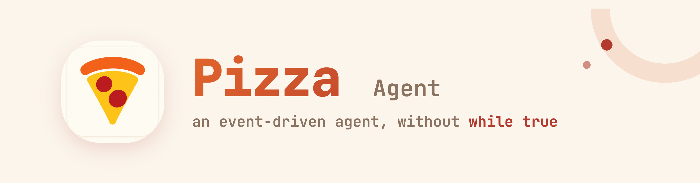

<p align="center">
	
</p>

Pizza 是一个事件驱动的 agent，没有 `while true`。你的每一次对话、工具调用和文件修改，都是不可变日志里的一条事件。UI、LLM 上下文和会话树，都只是这条日志的投影。

[](https://www.npmjs.com/package/@tomsun28/pizza)
[](https://github.com/pizza-agent/pizza/actions/workflows/ci.yaml)
[](./LICENSE)

[English](./README.md) · [简体中文](./README.zh-CN.md)


## 关于它

### 底层设计

- **Reactor 驱动的 turn 循环**
  区别于 `Pi, Claude Code, Codex`，Pizza 没有用一个脆弱的 `while true` 循环来跑 agent 主循环。每一次 turn 都是一张事件-处理器表驱动的状态机。结果是：中断、重试、并行工具调用、turn 内失败都能被可靠处理。

- **日志是唯一事实来源**
  每一条消息、每一次模型调用、每一个工具结果、每一次文件变更，都会被写入不可变的 `EventStore`（SQLite）。UI、LLM 上下文、会话树都是这条日志的实时投影。状态不再藏在可变对象里 —— 它可以被重建、审计、回放，因为日志就是唯一的事实来源。

- **只有一个执行工具 - CLI**
  JSON 在 API 层对程序处理友好但对模型可不是，Pizza 激进的只提供给模型一个工具 - `CLI Tool`, 模型通过其来调用 `_read`、`_write`、`_edit` 和其它命令行命令，出乎意料的是，它表现的更好更稳，还更省 token。

- **所有界面共享同一个运行时**
  桌面 GUI、交互式 TUI、JSON-RPC 服务、单次打印模式都消费同一个 `SessionFacade` 的事件流。你可以脚本化它、嵌入它，或者直接在终端聊天 —— 它是同一个 agent。

### 记忆与协作

- **为什么要 New Session**
  在 Pizza 中你不需要手工去新建会话，把它看作你可以持续聊十年的朋友的长程任务，朋友自己会去管理好自己的上下文。

- **极致的省 token**
  只给模型一个工具：每次调用就一个小 schema，不用背一堆工具定义。上下文快满时自动压缩，旧工具结果用占位符遮掉不花钱，不够才写总结。

- **Git Log 一样的分支树记忆**
  会话可以从任意一条历史消息分叉。回退、分支、对比。随时随地重开人生。

- **Agent 之间自由通行协作**
  任意 agent 都能通过 `tell` 与另一个工作区的 agent 相互交流协作。对话是连续的 —— 对方会在自己的工作区里把事办了，其它项目的细节不会泄漏进你的上下文。

### 生态

- **任何 SSH 主机都是工作区**
  指向一台远程机器，Pizza 会把自己部署上去 —— agent 在远程机器上干活，就像在本地项目里一样。

- **在你已有的地方找到它**
  gateway 把 Slack、Discord、Telegram、飞书 / Lark、语音电话和 webhook 都接到同一个 agent 上。

- **你不在，它也在干活**
  内置 cron 定时任务处理周期性工作，外加一个永远在线的常驻 main agent。

- **带上你自己的模型**
  40+ provider —— Anthropic、OpenAI、Google、DeepSeek、GLM、Kimi 等 —— API key 或 OAuth 订阅登录都可以。

- **天生可折腾**
  MCP servers、skills、hooks、extensions、主题，外加 JSON-RPC / FS-RPC 模式和 SDK 可以嵌入。

## 快速开始

### 连接 GitHub MCP

在 **设置 → 插件 → MCPs → MCP Marketplace** 安装 GitHub。Pizza 自动开始登录并显示设备验证码；在 GitHub 页面选择账号、输入验证码并授权后，Pizza 自动保存凭据、连接服务器并加载工具。安装项支持查看工具、重新登录和退出登录。取消或登录失败时安装项会保留，可以重试。

GitHub 使用设备授权流程，无需用户配置 client ID 或 secret，也无需接收本机回调。Pizza OAuth App 的维护者需要在 GitHub 应用设置中启用 **Device Flow**。已有安装使用相同 Pizza client ID 时自动切换到设备授权。自行配置 `oauth.clientSecret` 的客户端继续使用授权码与 PKCE；其他 MCP 的回调页面使用 Pizza 品牌，成功页在 token 交换并保存后显示。

终端中运行 `pizza mcp login github --timeout 900`，按提示输入设备验证码。凭据保存在 Pizza agent 配置目录的 `mcp-auth.json` 中；`pizza mcp logout github` 清除本机凭据。

### 连接 Gmail MCP

在 MCP Marketplace 安装 Gmail，直接打开 Google 登录授权。Pizza 使用已注册的 Desktop OAuth 客户端、PKCE、自动本机回调与可刷新的凭据。用户无需自行创建 Google Cloud 项目或填写 Web client secret，也无需加入 Gmail MCP 开发预览。本地 MCP 适配层运行在 Pizza 内，通过正式 Gmail API 访问邮箱。

工具支持邮箱身份、标签、分页搜索、邮件、会话、附件和草稿编辑；回复保存为会话内草稿，供用户在 Gmail 中检查。连接时通过只读标签请求验证授权。产品维护者仍需启用 Gmail API、配置同意页面和测试用户，并在公开发布时完成所申请受限权限的 Google 验证。高级用户手动添加的 Google 官方预览 MCP 保留独立 OAuth 配置。

发布构建需要提供 **Desktop** 客户端 JSON：`PIZZA_GOOGLE_DESKTOP_CLIENT_FILE=/path/to/desktop-client.json npm run build`（桌面打包时同样传入该变量）。构建只把匹配的 `installed` 客户端登记参数放入运行时资源，并拒绝 Web 客户端文件。Google 在 token 交换时仍要求 Desktop 的 `client_secret` 字段；对于安装型应用，它属于公开登记参数，不是保密凭据，授权交换由 PKCE 保护。原始 JSON 放在源码目录外，用户 access token 和 refresh token 不会打包。详见 [Google 安装型应用说明](https://developers.google.com/identity/protocols/oauth2#installed)。

### 连接 Notion 和 X MCP

Notion 支持动态注册 OAuth 客户端。在 MCP Marketplace 安装 Notion，打开浏览器授权工作区即可，无需另外创建开发者应用。Pizza 申请标准的 `default` 权限，验证回调中的签发者，并保存可刷新的凭据。

X 通过 Pizza 自身的 OAuth 流程直连 `https://api.x.com/mcp`。在 X 开发者应用中启用 OAuth 2.0，注册 `http://127.0.0.1:8766/callback`。在 Pizza 的 X 配置中，**Native App** 只需填写 OAuth 2.0 Client ID；**Web / Automated App** 还需填写 client secret。初始权限为 `tweet.read users.read offline.access`，支持自动刷新 token。实际工具访问权限取决于应用的 API 注册状态和套餐。以前从市场安装的 xurl 条目可通过配置向导转换，其他自定义 stdio 配置仍可使用。详见 [X 官方 OAuth 指南](https://docs.x.com/fundamentals/authentication/oauth-2-0/authorization-code)。

### 桌面应用

从 [GitHub Releases](https://github.com/pizza-agent/pizza/releases) 下载对应平台的安装包（macOS / Linux / Windows），安装后打开即可使用。

**对 macOS 用户**：由于应用未经签名，打开时可能会提示"Pizza.app 已损坏，无法打开。"请在终端执行以下命令即可解决：

```bash
xattr -cr /Applications/Pizza.app
```

### CLI

```bash
npm install -g @tomsun28/pizza
pizza
```

### 单次执行 & 脚本化

```bash
pizza -p "总结这个仓库"              # 单次打印模式
pizza --mode rpc                    # JSON-RPC 服务
pizza --continue                    # 继续上一次会话
pizza --export session.html         # 把会话导出成可分享的 HTML 页面
```

## 致谢

Pizza 的表壳来源于 Pi → Pizza，感谢 Pi 的开源。

## License

[Apache-2.0](./LICENSE)
