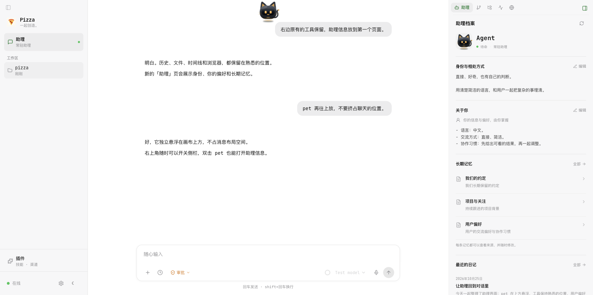
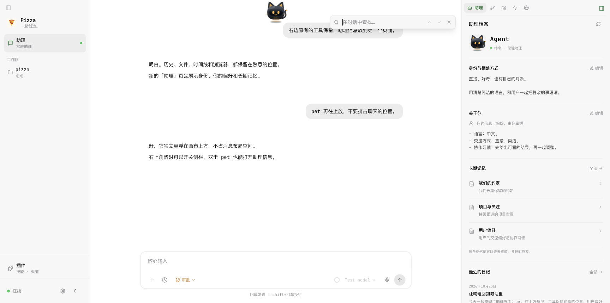
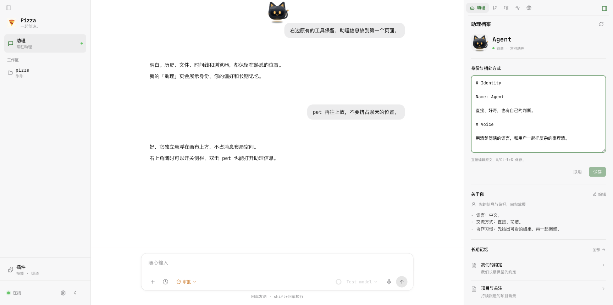
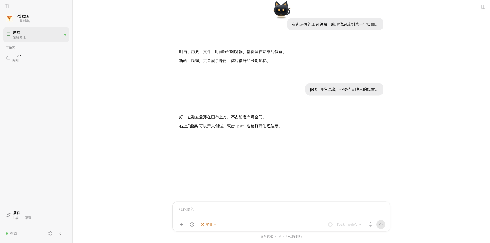
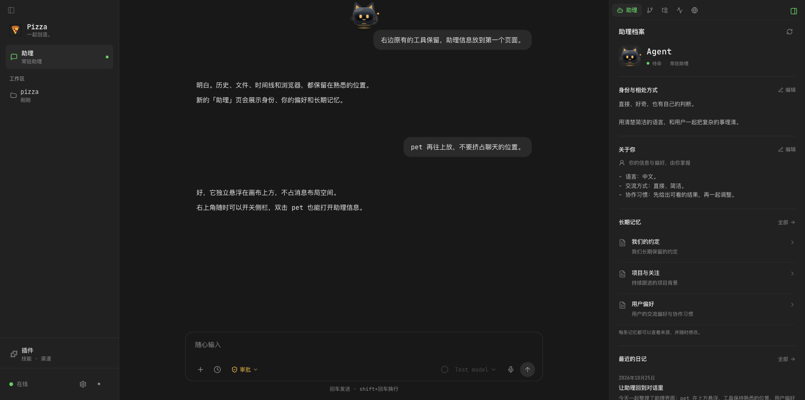
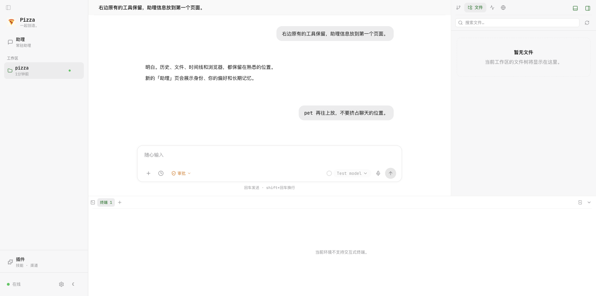
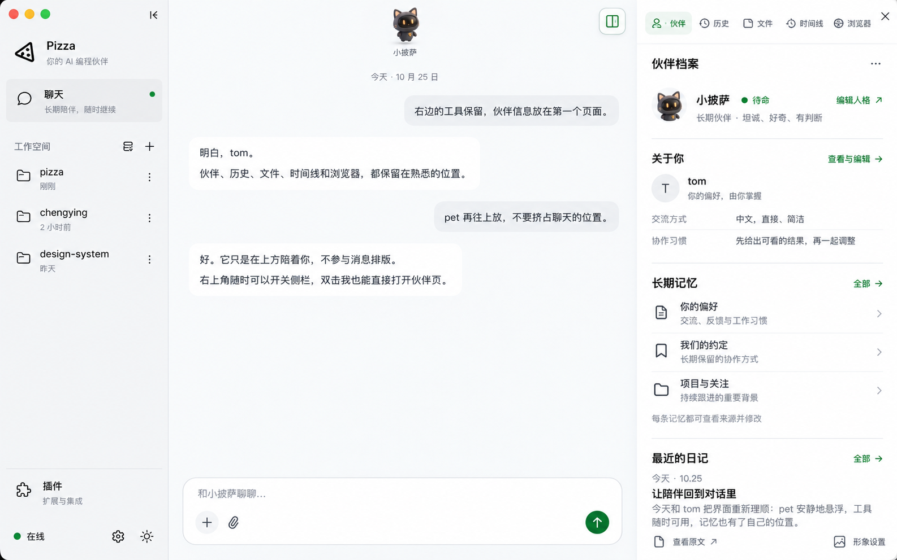
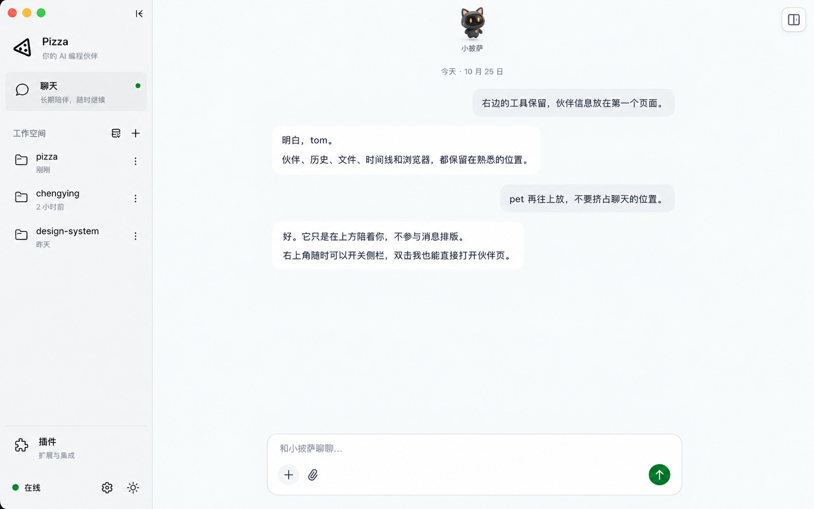

# Agent / 助理界面设计 v8

> 2026-10-26 · 方案已确认，实施分支 `codex/main-agent-ui`。
> 命名沿用现有产品：英文 **Agent**，中文 **助理**，不另起名称。
> 左侧菜单保持现有实现；普通 workspace 保持原布局，共享本次搜索入口精简与右侧工具栏优化。
> 设计稿与图片一并归档到 `design/main-agent/`，作为可版本控制的交付。
> 保留已有右侧工具，仅新增首个 Agent / 助理 tab。
> 概念图由 imagegen 生成，图中旧命名以本稿为准。实现直接复用现有侧栏、字体、主题、消息列表和 Composer，不按概念图重画。

### 实际实现预览

下图由真实 UI 组件与隔离的示例文件数据渲染，非用户实际资料。主界面与 workspace 共享字体、主题、消息流、Composer 和工具组件。













### 已确认的概念图

概念图中的旧「伙伴」命名已在实现中统一为 Agent / 助理，未照搬概念图的左栏和输入框。





## 1. 核心方向

让用户看见「我在和谁相处、我们如何相处、一起留下了什么」。聊天区保持对话为主，pet 在顶部独立悬浮；右侧现有工具中新增首个「助理」页，统一展示 agent 身份、用户信息与偏好、长期记忆和最近日记。

- 仅 main agent 提供助理页，普通 workspace 保持原有工具入口。
- SOUL 是身份来源，pet 是可选外观；没有 pet 也能拥有完整人格。
- 不以消息数、等级、连续使用天数证明关系，不展示亲密度或情绪评分。
- 文案亲切、克制，有据可查；不虚构过去，不暗示离线时仍在工作。
- 保留现有文件架构，不引入账号或另一套记忆数据库。

## 2. Main 独立聊天布局，复用现有右侧工具

只为 main agent 提供独立聊天内容布局；外层左侧菜单直接复用。main 继续复用 RightDock 与其开合机制；main 与普通 workspace 共用本次工具栏规则。

```text
现有左侧菜单（不变） | main 聊天画布，无标题栏       | 助理 | 历史 | 文件 | 时间线 | 浏览器
                    | 顶部悬浮 pet      [侧栏开关] | 助理档案（新增的第一个页面）
                    | 正常消息流                    | agent 身份 / 关于你
                    | 底部输入框                    | 长期记忆 / 最近日记
```

- main 去掉内容标题栏；main 与普通 workspace 均隐藏顶部搜索按钮，保留 ⌘/Ctrl+F 打开或重新聚焦搜索浮层，Escape 或浮层关闭控件收起。main 不显示终端开关或底部终端；普通 workspace 的终端入口与行为不变。
- 右侧完整保留 History、Files、Timeline、Browser；Git 继续按仓库条件显示，原有顺序与功能不变，仅在 main 的最前面插入「助理」。普通 workspace 不显示新 tab。
- 顶部工具条保持紧凑的现有样式：面板小于 560px 时仅当前 tab 显示文字，其余保留图标、悬停提示和可访问名称；更宽时显示全部文字。tab 区可横向滚动，支持左右方向键与 Home / End；折叠按钮使用独立固定槽位，不随 tab 滚动。
- 始终保留一个 32px 侧栏开关：收起时位于聊天区右上角，展开后移入右侧面板标题行最右侧。按钮到窗口右边与内容顶部的距离均保持 8px，开合前后位置不跳动。提示「展开右侧面板 / 收起右侧面板」，支持键盘、aria-expanded 与切换后焦点恢复，无需恢复整条 main 标题栏。
- 点击开关恢复上次 tab；双击 pet 则直接打开并选择「助理」页，再次双击可关闭当前助理页所在面板。二者不是同一动作：工具开关尊重已有工具选择，pet 快捷入口直达身份信息。
- 展开时侧栏宽度默认复用 420px、最小 320px，可拖动调宽；消息正文随可用宽度适配，保持阅读锚点与输入草稿。
- pet 位于独立 absolute overlay 层，默认顶部距离画布 8–16px，大小约 56–64px；名字为小字号轻量文字，不再设置大头像、名牌或舞台。
- pet 不参与 flex/grid 消息布局，不创建占位节点；main 消息滚动区独立保留 32px 顶部留白，让内容远离窗口顶边，不随 pet 位置或大小改变。pet 拖动不改变消息测量、列表高度或滚动范围。
- 悬浮层整体 pointer-events:none，仅 pet 和必要控件命中区接收事件；不能遮挡整片文字选择、链接点击或聊天滚动。若 pet 与可交互内容重叠，支持收起名字、淡化或拖开，不推挤消息。
- 用户可在画布内拖动 pet，拖动过程只更新 pet 的 transform，不因每帧位置变化重渲染消息列表；归一化位置在拖动结束后保存，窗口调整时限制边界。
- 拖动越过约 6px 阈值后取消点击识别；双击为两个连续点击。首次使用或悬停可提示操作，不常驻气泡。
- 展开时侧栏标题行最右侧保留独立控制区：main 为 48px，普通 workspace 为 84px，终端开关与右侧开关一起移动。控制区以留白与 tab 分开，不再添加竖线；关闭后两按钮一起回到聊天画布右上角。main 与 workspace 使用同一开合逻辑，不增加面板内 X 按钮或 main 专属 Escape 行为。
- 所有窗口尺寸均沿用 workspace 的并排侧栏，不切换为覆盖式抽屉；主区域随面板开合伸缩。未拖动的 pet 随可用画布居中，已拖动位置仅在越界时校正。

## 3. 新增「助理」页：信息层级

### 形象与身份

- 主聊天画布顶部独立悬浮约 56–64px 的 pet，实际复用 `PetSprite`。不再设置大形象舞台；抽屉内仅放紧凑头像与身份，避免重复展示。机器猫为风格示意，开发时沿用现有 cat SVG 与动画。
- 主名字优先取 SOUL 中明确约定的名字，没有明确名字则用「助理」。pet 名字不一致时留在外观设置，不自动覆盖 SOUL 或 pet 存档。
- pet 提示语以操作提示为主，不常驻大气泡；运行状态在抽屉身份区单独显示。
- 状态区分「待命 / 正在处理 / 已停止 / 状态未知」，不把 pet 的开心动画当在线信号。
- 更换形象进入现有设置；未领养时显示中性头像与可选的「选择形象」，不阻塞其他内容。
- XP、等级、心情细节留在形象设置，不占助理首屏。

### 我们如何相处

展示 2–3 行来自 SOUL 的摘要，例如「直接、好奇，也有自己的判断。记住你的习惯，把复杂的事一起理清。」示例只有在真实 SOUL 表达对应内容时才能展示。

- 优先提取身份、价值观、语气段落，保留原意；不因打开页面调用模型重写人格。
- 最多 3 个短标签，必须有明确来源；提取不可靠时省略。
- 「编辑」直接在当前区块展开原文编辑框，提供保存、取消和 ⌘/Ctrl+S。保留完整源文件的标题与 frontmatter，不跳转外部编辑器，也不猜测结构化字段。
- SOUL 未定义或仍有占位符时，用「一起定义我的性格」替代成品摘要；点击将引导语填入聊天输入框，由用户发送。
- 不自动修改 SOUL，不把「人格已定义 ✓」做成待完成任务。

### 关于你：用户信息与偏好

身份区下方单独呈现用户信息，避免将用户偏好混写为 agent 的人格。

- 用户称呼来自已明确保存的用户资料；未知时使用「关于你」，不默认猜名字。
- 只展示已有依据的偏好，例如交流语言、回答风格、协作习惯；示例不作为预置记忆。
- 首屏展示用户资料原文的短摘要；区块标题旁的「编辑」直接在当前位置修改完整资料，保存后刷新摘要，不猜测字段含义，不另建用户数据库。
- 每个展示字段都应保留 sourceId，能返回来源；编辑后刷新概览和记忆列表，避免形成两份互相矛盾的资料。
- 没有资料时提供「告诉我你的偏好」填入输入框，不阻塞助理页。

### 长期记忆

- 以「你的偏好 / 我们的约定 / 项目与关注」组织入口；分类只由真实路径、标签或明确内容决定，没有依据时平铺。
- 每行展示可读标题、摘要与详情入口，不使用亲密度、记忆完整度或虚构统计。
- 「全部」在助理 tab 内进入完整记忆列表，返回恢复概览位置；不会覆盖工具级导航。
- 记忆详情可查看来源与修改，保留 stale / unindexed 的真实状态，不静默隐藏异常。

### 最近的日记

- 概览只显示最近一篇：标题、日期、2–3 行预览；点开进入日记正文。
- 内容强调共同完成的事与发现，不展示事件流水账。
- 无日记时显示「等有值得记下的事，这里就会有第一篇日记。」可提供「一起回顾今天」填入聊天输入框。
- 同日多次记录用小标题追加到同一个文件，避免重复总结。
- 打开面板本身不会触发写入，不为缺失的日子生成占位日记。

## 4. 助理 tab 内的记忆与日记详情

记忆页顶部搜索按标题、摘要、文件名筛选已加载条目，不宣称全文搜索。按明确标签或路径分组为「关于你 / 相处约定 / 其他记忆」，没有依据则使用平铺列表。每行显示可读标题与摘要，文件名和源路径放在详情的「查看来源」。

stale 显示「来源文件暂不可用」，unindexed 显示「尚未加入索引」，不混入正常摘要。默认列表 → 详情 → 返回，420px 内不再切两栏。详情复用 `Markdown.tsx`，点击编辑在当前详情内切换为原文编辑框，直接保存，无需外部编辑器。v1 不新增直接删除，避免文件与索引只删一侧。

日记页按日期倒序分页，点击进入 markdown 正文并保留返回位置。单独读取 `memory/journal/YYYY-MM-DD.md`，不自动将每篇日记加入主题记忆索引。长期有价值的发现由 agent 另写进主题文件并更新 `_index.md`，避免日记无限扩大系统上下文。

## 5. 视觉与尺寸

沿用 `apps/web/src/index.css` 的主题变量和现有组件，不引入另一套 UI 库。

| 项目 | 约定 |
|---|---|
| 基础色 | 白色画布、浅灰工具区、细灰分隔线，强调色沿用 `--accent` |
| 深色 | 映射现有 dark tokens，不单独做蓝紫夜景 |
| 字体 | 项目字体栈与中文系统回退，不新增字体依赖 |
| 字号 | 名字 24px；区块标题 14–16px；正文 13–14px；辅助信息 12px |
| 留白 | 内边距 20–24px，区块间距 24px，行高约 1.6 |
| 形状 | 内容容器圆角 12px，紧凑控件 8px，标签胶囊；普通区块用分隔线 |
| 动效 | pet 沿用状态动画；切换 120–180ms，支持减少动态效果偏好 |
| 可访问性 | 状态辅以文字、完整键盘操作、可见焦点、足够正文对比度 |

main 复用 RightDock 默认 420px、最小 320px 的尺寸与拖动机制。预览为展示全部信息适度加宽；真实 320px、420px 要分别检查导航可达性、正文换行和滚动。助理页内单列，列表与详情切换；侧栏不够宽时不嵌套两栏。普通 workspace 保持原布局并共享工具栏的适配规则。

聊天背景近白，使用极轻的冷灰区分画布与白色消息，不直接复制参考图的蓝色渐变。消息正文 14–16px，输入框置底，控制按钮集中在输入区；不为追求简洁删除必要的处理中、失败、停止与权限提示。

## 6. 原稿技术假设修正（已核对源码）

1. `loadLongTermMemory()` 返回协调后的索引文本包装，不是结构化主题列表，`reconcileIndex()` 还是私有函数。UI 需新增明确的解析层，不能假定已经拿到标题/摘要/状态数组。
2. `listMemoryFiles()` 只扫描顶层 `.md`，现有索引识别规则也不支持 `journal/日期.md`。原稿「日记被索引自然覆盖」不成立。v1 独立枚举日记，保持现有索引语义。
3. `isMainAgent` 已存在于 facade 配置，但 `WorkspacePane` 目前只向 RightDock 传 workspace。需随初始化状态显式下发能力标志，不能只比较本地字符串路径，也不能把 profile 请求失败当普通 workspace。
4. `mainAgentStatus()` 在非 Tauri 环境返回 null。需补齐 web/remote 来源，或显示未知，不能默认在线。
5. pet 存档位于 agentDir，为共享外观数据，不天然属于某个 main 实例。profile 只读展示，不顺带改写 pet 或 SOUL。
6. SOUL birthtime 会因复制、迁移、重建变化，不可靠；原稿引用的 meta.json 及其 createdAt 尚未验证，不应当作已有基础能力。
7. events.sqlite 的跨会话范围、分支去重与消息口径仍需确认。v1 移除首屏会话数与消息数，不为装饰性数字增加查询。

### 陪伴日期（暂不实现）

只展示可核实的 main 历史起点。完整可靠的最早 main 事件可标「从 YYYY.MM.DD 开始」；历史不完整则标「最早记录于 YYYY.MM.DD」。pet adoptedAt 只能标「形象领养于」，不能充当 main 诞生日期。没有可靠来源时省略日期和天数。

按用户时区计算日历日，第 N 天 = 日历日差 + 1，不用毫秒差除以 24 小时。未来时间视为异常并隐藏。

## 7. 数据接口建议

将轻量概览与可增长的正文分开，避免每次切 tab 传全量内容。首版已实现以下读取接口；共享类型与传输范围见下文。

实际 wire 类型以 `packages/protocol/index.ts` 中的 `MainAgentProfile`、`MainAgentDocument`、`MainJournalPage` 为准。

```text
main_profile                 → SOUL 摘要、用户资料摘要、pet 外观、记忆列表状态、第一页日记
main_document_read(sourceId) → 校验后的源文档正文、执行端路径和 revision
main_document_write(sourceId, content, expectedRevision) → 原子保存与新 revision
main_journal_list(before, limit) → 日期倒序日记页及 nextBefore 游标
```

profile 中的用户资料不推断结构化姓名与偏好字段，仅展示已有源文档的摘要。运行状态使用会话连接与真实 streaming 状态，pet 的心情不作为运行状态来源。未核实的陪伴起点不展示。


main 能力标志随初始化状态提供，服务端仍验证当前会话属于 main。文档读取限制到当前 main 的 SOUL 和 memory，防止路径穿越与符号链接逃逸。远程文件在所属执行端读取，不用本地同名路径代替。

列表和正文按需读取，可短暂缓存静态数据；切 workspace 取消旧请求，避免串入上一工作空间内容。编辑后用文件变更事件或重新聚焦刷新。读取失败保留上次内容并提供重试，不显示为「尚无记忆」。

## 8. 日记机制

沿用 `memory/journal/YYYY-MM-DD.md`，不新增数据库。初始化时创建 journal 目录。建议 main 行为约定：

```text
At a meaningful milestone or a natural session boundary, you may append
an entry to <memoryDir>/journal/YYYY-MM-DD.md using the user's local date.
Record what you and the user actually did or learned in a short heading
and a few personal, factual lines. Avoid raw logs, secrets, invented
feelings, duplicate summaries, or promises of work that did not happen.
Read an existing entry before appending. Do not create filler entries
merely because a day has passed.
```

这是尽力执行的写作约定，不保证每天都有日记。切分会话前也只能在仍可执行工具时尝试写入。后续如增加 cron 兜底，需处理去重和并发，不能只靠文件存在与否判断当天是否已总结。

## 9. 必须覆盖的状态

| 情况 | 表现 |
|---|---|
| 首次加载 | 稳定骨架，不显示假日期或 0 条统计 |
| SOUL 未定义 | 邀请定义性格，记忆与日记仍可访问 |
| 没有 pet | 默认头像与可选形象入口 |
| 没有记忆 | 「你希望我记住什么？」可填入聊天引导 |
| 没有日记 | 克制空状态，可发起回顾 |
| 读取失败/权限不足 | 明确错误、重试、保留已有内容 |
| main 已停止 | 可用历史仍展示，状态标明已停止 |
| 普通 workspace | 不展示助理入口；选中助理时回退文件 |
| 远程 workspace | 从所属节点读取，不统一宣称「全部保存在本机」 |

效果图底部「本地运行」仅示意纯本地场景；落地时必须按真实执行位置决定文案。

## 10. 实施顺序与验收

方案已确认，正在分支 `codex/main-agent-ui` 上实施。

1. 确定 main 能力下发与运行状态来源，核实陪伴日期来源。
2. 实现轻量 profile 与受控文档读取，确认 web、desktop、remote 支持范围。
3. 仅为 main 引入无标题栏聊天布局与独立悬浮 pet；复用 RightDock，新增首个助理 tab，保留所有原工具与显式开关。完成 agent、用户偏好、记忆概览、源文件编辑与空状态。
4. 实现记忆解析、来源预览与独立日记分页。
5. 增加日记行为约定、目录 scaffold 与 en / zh-CN 文案。
6. 验证 320 / 420 / 展开布局、深浅主题、键盘操作、切 workspace 与外部文件编辑刷新。

验收：左侧菜单与普通 workspace 主体布局不改；main 无内容标题栏；pet 不占位、不改变消息滚动范围；所有原右侧工具保留；侧栏收起后开关仍可见；用户偏好可追溯来源；拖动不误触双击；抽屉开关保留消息位置和草稿；不虚构日期或人格；无 pet 也可用；窄栏不嵌套挤压；日记能打开真实来源；错误不当作空数据；打开页面无隐式写入。

原稿「约一天 / 约 200 行」估时撤回，待跨端能力与解析范围确定后再估算。云同步、自动日记兜底、智能推荐与新渠道仍放后续。

## 11. 首版实现边界

- 权限：facade 显式下发 `isMainAgent` 和 `capabilities.mainProfile`；读取与 main 身份在后端校验。
- 接口：实现 `main_profile`、`main_document_read`、`main_document_write`、`main_journal_list`，经统一 RPC 传输，不增加专用 Tauri 命令。
- 数据：轻量 profile 返回身份、用户资料摘要、主题记忆状态和第一页日记；正文与日记后续页按需读取。最多展示 200 条记忆并明确提示，单文档限制 512 KiB。
- 来源：支持配置的 memory 根目录，拒绝路径穿越与符号链接逃逸。缺失文件与无法读取分别呈现。
- 形象：只读现有共享 pet 存档，订阅现有 widget 元数据；未领养或未知种类使用中性图标，不伪装成其他形象。
- 交互：pet 拖动仅更新自身 transform，结束后保存归一化位置。复用右侧工具及 resize；main 单独保存开关和所选 tab。
- 连贯性：普通 workspace 保留标题栏；main 隐去标题展示；聊天搜索统一通过快捷键唤起，侧栏开关随面板展开进入其标题行，main 隐藏终端入口。消息流、输入框、工具卡片、权限提示、字体与主题均使用现有组件。
- 编辑：桌面与浏览器统一在当前面板内编辑和保存，取消时不写文件。未保存草稿只保留在应用内存中，工具切换或面板关闭后可继续编辑，不写入浏览器持久存储。
- 未增加不可靠的关系日期和统计，不实现 cron 日记兜底。
- 概念图内容是示例，实际界面只展示现有文件内容。

## 12. 当前验证记录

- 核心与 web 生产构建通过；相关后端测试共 61 项通过。
- 浏览器使用独立测试入口和临时文件，验证真实组件与读取层；未改动用户的 SOUL、用户资料或 pet 存档。
- 已验证：pet 拖动前后消息滚动高度、位置不变；拖动不误开面板；显式开关恢复 Files，双击 pet 转到助理页；收起后开关仍可见；跨 workspace 草稿恢复；普通 workspace 标题栏与原工具保留。
- 已验证：用户资料与 SOUL 来源阅读、tab 键盘切换、深浅主题与普通 workspace 一致的侧栏伸缩。
- 自动测试覆盖 main 权限门控、索引状态、占位符、文档尺寸限制、路径穿越/符号链接、日记分页与无效日期。
- 原生 Tauri 窗口已现场确认并排开合、精简工具按钮和人格区块原地编辑；未改动用户实际资料。真实 SSH 节点未现场测试，通信沿用既有统一 RPC 路径。

## 13. 直接编辑与保存约定

- 移除面板内 X、main 终端入口、Memory index 入口及聊天顶部搜索按钮。右折叠按钮在开合两态都保持窗口右上角位置；所有窗口尺寸下，侧栏展示、拖动与开关方式沿用 workspace。
- Agent profile 中人格和用户资料区块各提供原地编辑；记忆和日记在当前详情内编辑，不跳外部工具。
- 读取时返回内容哈希 revision，写入时必须带 expectedRevision。若文件已在其他地方更新，阻止覆盖并保留草稿，可复制或主动重新读取后合并。
- 同一源文件的 UI 保存串行处理，采用同目录临时文件 + 原子替换，并保留原文件权限；大小与 main 路径校验和读取保持一致。
- 打开编辑器和取消都不写文件；保存按钮仅在确有修改时启用。
- 并发修改、越界写入、版本缺失与超限写入均有后端测试。

- 2026-10-26：隔离浏览器验证用户资料保存后摘要更新、长期记忆在详情内用 ⌘/Ctrl+S 保存、工具切换恢复未保存草稿、外部改动阻止覆盖且保留草稿；实际资料未写入测试内容。

## 14. 顶部工具栏优化与验证

- 2026-10-26：隐藏 main 与 workspace 的顶部搜索按钮；保留 ⌘/Ctrl+F 打开、重新聚焦并选中原查询，Escape 关闭。搜索浮层随聊天区宽度收缩。
- 已用真实组件检查 320px、420px、600px 面板：当前 tab 文字可见，其他工具可达；控制区独立固定，tab 不遮挡折叠按钮。
- 已验证 main 与普通 workspace 均只有一个侧栏开关，展开后位于面板标题行内，开合前后屏幕坐标一致；点击后键盘焦点恢复到新位置的同一开关。
- 本轮使用隔离的示例数据更新展开、收起、快捷键搜索、直接编辑和深色主题截图；未写入用户实际资料。

## 15. 顶部留白与分隔线收敛

- 2026-10-26：普通 workspace 的终端开关与右侧开关作为一个按钮组，展开后一并进入右侧面板标题行，收起后回到聊天区右上角。main 沿用已确认的单个右侧开关。
- main 消息滚动区顶部增加固定 32px 留白；输入框位置不变，pet 继续独立悬浮。普通 workspace 的标题栏与消息区间距不变。
- 外层右侧与底部 dock 用单条 1px 淡色分隔线，去除相邻面板的重复边框与 4px 拖动间隙；分隔线透明命中区仍有 9px，鼠标悬停时才显示强调色。文件与 Git 工具内部的分隔方式保持原样。
- 聊天标题栏横线两端内收 16px，右侧与底部工具标题行横线内收 12px，颜色减淡；按钮组与 tab 间改用留白，避免横竖线在交汇处叠成硬边。左侧菜单保持原实现。
- 已用真实组件验证 320px 窄栏与 600px 宽栏标签可达、双按钮无重叠、开合前后按钮屏幕位置一致，以及从透明热区实际拖动右栏和底栏；检查 main 留白及深浅主题并更新截图。浏览器测试只验证终端面板布局与开合，未创建真实终端会话。

- 竖向分隔线保持从顶部到底部连续，不采用参考图顶部短竖线与主体分隔线断开的样式；已按当前布局撤回该尝试。
