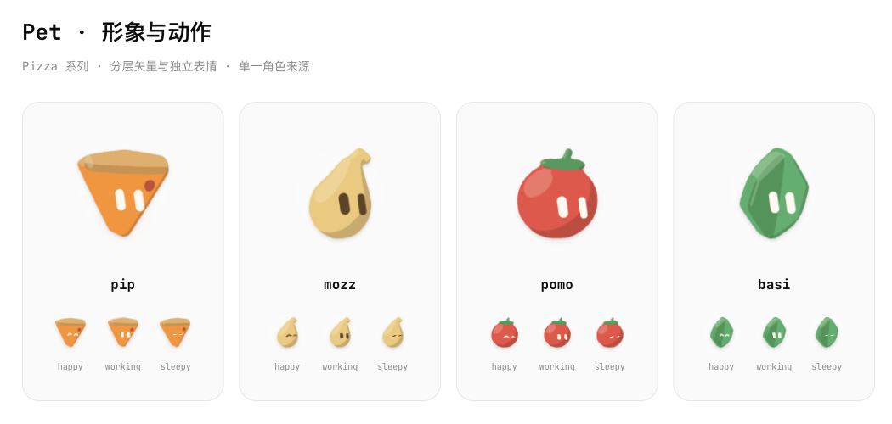
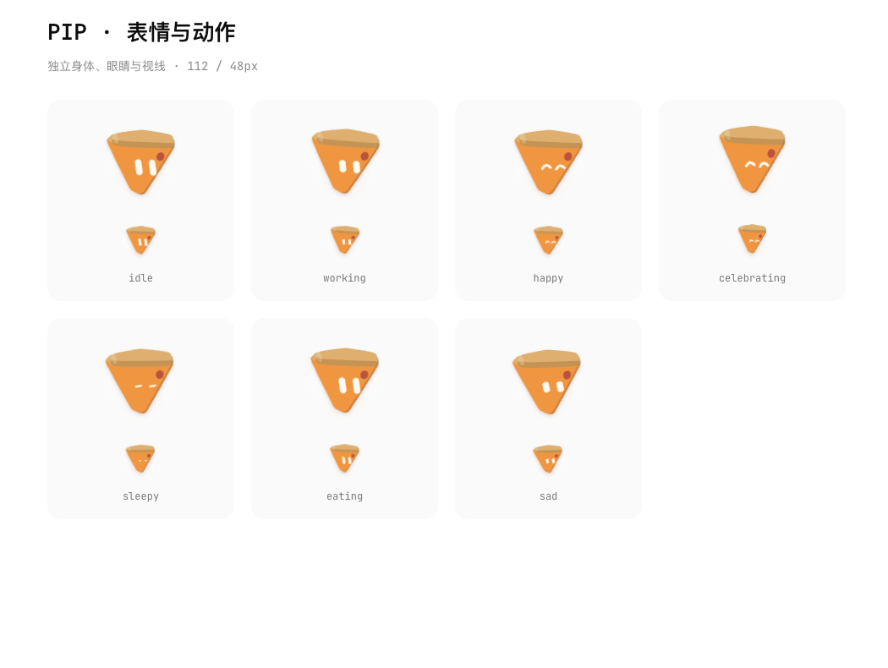
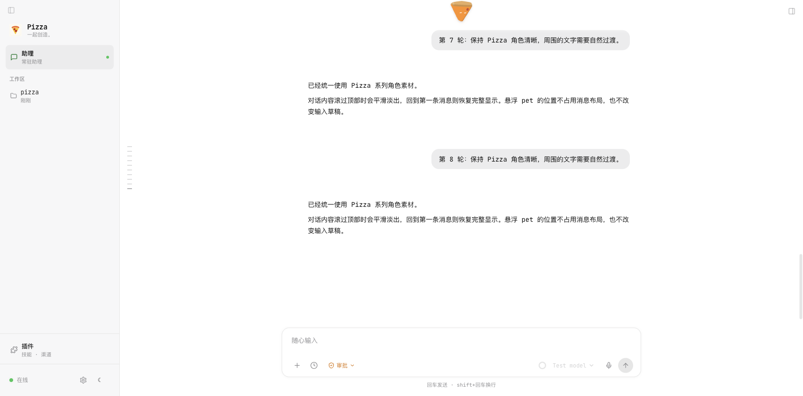

# Pizza pet · 分层矢量 v4

2026-10-27。当前实现采用「离线立体造型 → 分层 SVG → 身体、眼睛、视线各自动画」。v2/v3 的实时 WebGL 和图片动画已移除，不再作为当前视觉方案。

[实际动画与交互预览](images/pizza-motion-v4.mp4)

## 角色与视觉

| 角色 | 轮廓与配色 |
|---|---|
| PIP · 默认 | 短胖圆角披萨，橙色芝士面、厚饼边、单枚香肠点；两条带透视倾斜的浅色胶囊眼睛 |
| MOZZ | 暖金色芝士滴，柔软圆底和卷起的顶部；咖啡色眼睛 |
| POMO | 珊瑚红番茄球，小绿叶冠；浅色眼睛 |
| BASI | 饱和绿的折叠叶片，安静的侧面明暗；浅色眼睛 |

保持清楚轮廓、有限色块、侧面阴影和少量高光。去掉 v3 的大眼白、瞳孔描边和常驻嘴，不使用食物照片纹理。眼睛用稳定填充，保证浮在不同桌面背景上时仍能辨认。形状、投影与矢量路径均为原创 Pizza 资产；DS-Bot 的分层思路与动作节奏作为参考，未搬用其角色路径。调研见 [DS-Bot 实现笔记](ds-bot-reference.md)。

## PIP 表情与动作

- 待命：大部分时间保持稳定姿态，偶尔短摇头或伸展；眼睛独立眨动、略微睁大。
- 工作：轻微前倾和小幅摆动，眼睛收窄；不添加虚构的思考状态。
- 开心：弧形笑眼，小幅身体摆动。
- 庆祝：短跳与挤压回弹。
- 犯困：缓慢呼吸、闭眼，间歇抬眼看看。
- 进食：短促的挤压拉伸。
- 失落：轻微垂落和眯眼，避免强烈哭泣或负担文案。

靠近时目光跟随，停在角色周围时倾身、闭眼笑；轻触有短促回弹。交互不会伪造 agent 的工作状态。保留既有 7 个 mood，工作表现仍由真实 busy / streaming 数据驱动。

## 当前运行方式

- `apps/web/scripts/generate-pet-shapes.mjs` 用软体积和固定投影生成身体、贴花、阴影、高光、眼睛位置，输出 `src/components/pet-shapes.ts`。生成器无额外依赖；不会在应用启动时运行。
- 运行时使用普通 SVG、CSS 关键帧和过渡。眼睛和身体是独立图层；不是对整张图片反复平移，也不持续渲染 WebGL、播放视频或读取精灵图。
- 指针更新共用一组监听与 rAF 合并，直接写 CSS 变量，不因每帧目光变化重渲染对话列表。
- 每个角色实例有独立 clip id，防止资料页、设置页与当前角色互相引用；切换种类同步替换矢量数据，不等待素材下载。
- 页面隐藏、角色移出视野、主界面角色交给悬浮窗口后暂停动画；尊重系统减少动态效果。
- SVG 无异步素材首帧。隐藏的原生 pet 窗口完成挂载后通知宿主显示；仍沿用拖出、右键悬浮、双击返回和单一活动窗口机制。
- 插件与用户定义的 ASCII 动画继续使用原通道；默认目录仍仅为四个 Pizza 角色。旧默认形象迁移和版本合并保持不变。

在 `apps/web` 下执行 `npm run pets:bake` 可重建形状，`npm run pets:check` 验证重现结果、几何数据和眼睛范围。

## 对话中的呈现

默认贴顶，矢量身体在透明框内保留运动余量；默认可见顶部约 2px。后续用户拖动仍会保存位置，不改变消息的测量或滚动。角色外侧保留很小范围的柔化和局部投影，名字仅悬停或聚焦时显示；Small title 已移除。

消息顶部渐隐继续独立工作：历史起点为 0px，滚过内容后最多 40px；普通 workspace 上限为 24px。输入框、pet 和侧栏不参与消息遮罩。

以上归档截图与录屏来自隔离的示例数据；未将用户真实资料截图放入仓库。

## 本轮验证

- Web lint、类型检查、生产构建通过；原有刷新与浏览器组件警告保留。
- 四个角色的矢量数据可精确重建，眼睛数量、坐标和路径有效。
- 浏览器验证 16 个同时展示的角色、唯一 clip id、无运行时 canvas、完整睁闭眼、视线跟随、悬停笑眼、轻触回弹、7 个 mood。
- 验证拖动前后消息高度和滚动位置不变，刷新恢复拖动位置；新测试来源默认位置贴顶，消息渐隐从 0px 到 40px。
- 原生桌面确认新版 PIP、右键菜单、独立悬浮显示和双击返回应用；保留现有资料页与 workspace 布局。

## 设计迭代记录

以下是历史方案，保留用来追溯探索过程，并不代表当前运行效果：

- v1：[系列概念板](images/pizza-family-v1.png)、[PIP 八状态概念板](images/pip-states-v1.png)。由 imagegen 生成，提示词见 [prompts.md](prompts.md)。概念板中的 thinking 不新增为无来源运行状态。
- v2：[实时 3D 初版](images/realtime-3d-demo.mp4)。
- v3：[大眼睛与嘴部探索](images/expressions-v3.mp4)。该方向经用户反馈撤回。
